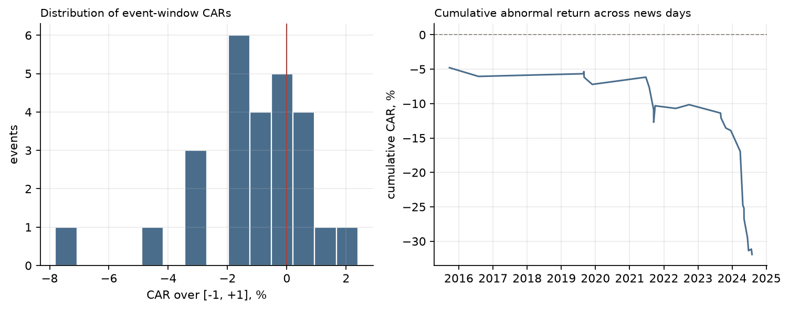

# speech-event

Does BRI CEO-speech news coincide with abnormal moves in BBRI? This repository now answers
that question with a proper event study, after finding that the original pipeline could not
have answered it at all.

## The finding

The original analysis flagged days whose return deviated from a market model by more than two
standard deviations, then looked for news on those days. Two problems:

1. **It selected on the outcome.** Choosing days by return and then asking whether news happened
   on them guarantees a certain amount of "matching" and attaches no sampling distribution to it.
2. **The merged table had no events.** The table the dashboard read (`dataset/sea_labeled.csv`)
   contains 32 news rows and its label column is `{0: 32}`: every one of them is a day the rule
   did *not* flag. The dashboard was comparing news days against a table in which the abnormal
   flag was never true, so its "overlap" was structurally zero.

Rebuilt with the direction reversed — **news is the event, abnormal return is the outcome** —
and with tests that have known sampling distributions:

| Test | Statistic | p | Reading |
|---|---|---|---|
| Patell Z (26 events, CAR [-1,+1]) | −2.84 | 0.0045 | mean CAR −1.23%, significant |
| BMP cross-sectional t | −3.24 | 0.0034 | holds after allowing event-induced variance |

One of 26 events survives Benjamini–Hochberg at a 5% FDR. That is the honest shape of a
small-sample result: a consistent negative drift, no single dramatic day.



The timing decomposition is in the generated report: the mean abnormal return is −0.39% at
t−1, −0.50% on publication, −0.34% at t+1. The pre-publication component means some articles
are published *into* weakness that had already started, which weakens a clean
"market learned the news and repriced" reading.

## Method

- **Events**: 41 article publication dates (2015–2024), collapsed to one per calendar day and
  mapped to the last trading day on or before publication. 26 fall inside the price series with
  a full estimation window.
- **Estimation window**: `[-130, -11]` trading days, market model `r_i = a + b·r_m + e` against
  the IHSG, fitted per event.
- **Event window**: `[-1, +1]`, CAR = sum of abnormal returns, with forecast-error variance per
  day (Patell standardisation).
- **Tests**: Patell Z for the aggregate, BMP cross-sectional t as a check that does not assume
  constant event-induced variance, and Benjamini–Hochberg across events.
- **Runs**: `out/<run_id>/results.json`, `REPORT.md`, `fig_car.png`.

## Reproduce

```bash
uv venv .venv && VIRTUAL_ENV=.venv uv pip install pandas numpy scipy matplotlib
.venv/bin/python event_study.py
.venv/bin/python -m pytest tests -q
```

No Postgres, no Ollama, no network: the script reads the committed price and article CSVs.

## What is still in the repository

| Path | Contents |
|---|---|
| `event_study.py` | The corrected study: mapping, market model, Patell/BMP tests, BH correction, report and figure |
| `out/` | Committed runs, each with results.json, REPORT.md and the CAR figure |
| `notebooks/` | The original pipeline: price pull, news crawl into Postgres, the 2-SD labelling, LLM sentiment scoring, and the join that produced the empty event table |
| `Home.py`, `pages/` | Streamlit dashboard over prices, articles and sentiment scores |

The notebooks are kept because the correction is only legible against what they did. The
dashboard is not the finding; `event_study.py` is.

## Stack

Python · pandas · NumPy · SciPy · matplotlib · statsmodels (original notebooks) · yfinance ·
Streamlit · Plotly · PostgreSQL (original news store) · Ollama llama3 (sentiment pass)

## Limitations

- 26 events with a full estimation window. The BMP test is the more trustworthy of the two here,
  but neither has power to detect effects smaller than roughly 1% CAR.
- The market model assumes a stable beta; a structural break around an event biases the
  abnormal return.
- Publication timestamps are not the moment the market learned the news. After-close articles
  are attributed to that day, shifting some events by one session.
- Other news on the same day is not separated from the CEO-speech coverage.

---

## Data provenance

`notebooks/**/*.csv` contains article text scraped from Indonesian news publishers (including
kompas.com, republika.co.id, bisnis.com and infobanknews.com) together with daily price history
for BBRI and the IHSG sourced from Yahoo Finance.

The article text belongs to its respective publishers and the price data to its provider.
Neither is **our work**, no licence is asserted over either, and both are committed only so that
the event study can be reproduced without re-crawling. The analysis code is ours (MIT).
